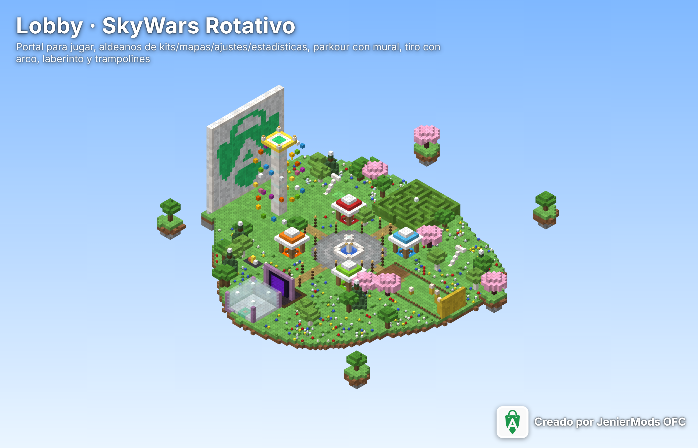
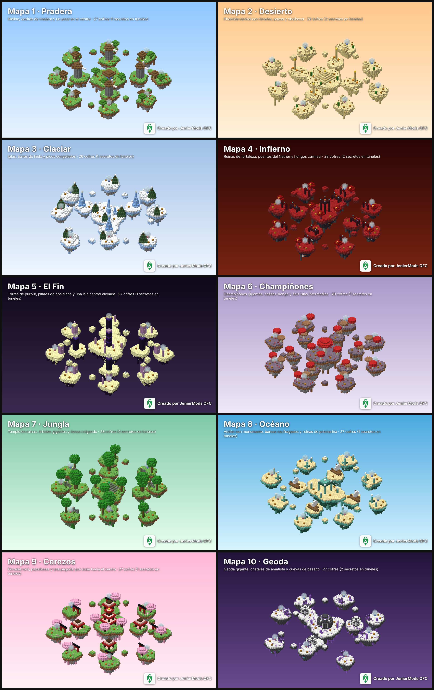

# SkyWars Rotativo · Creado por JenierMods OFC


Minijuego de SkyWars para **Minecraft Bedrock 1.21+**: **10 mapas que rotan entre partidas** y un **lobby con minijuegos**. Está inspirado en el clásico *SkyWars (10 Maps)* de Team Cubitos MC, con las mismas funciones principales pero con islas, temas y código originales.



## Lobby

El lobby es una isla aparte, a 1000 bloques de la arena, así que desde las islas de juego no se ve.

| Zona | Qué hace |
|---|---|
| **Portal (JUGAR)** | Entras al portal y pasas a la **sala de espera** (la cola). La partida empieza sola cuando hay jugadores suficientes. Si ya hay una partida en curso, el portal te lleva a **mirarla como espectador** |
| **Sala de espera** | Muestra cuántos hay en la cola y la cuenta atrás. Para **salir de la cola**, te paras en el bloque verde |
| **Aldeano de Kits** | Eliges entre 8 kits (Constructor, Guerrero, Arquero, Explorador, Médico, Demoledor, Pescador o sin kit) |
| **Aldeano de Mapas** | Lista de los 10 mapas con su descripción, y **votación** del siguiente mapa |
| **Aldeano de Estadísticas** | Tus victorias, asesinatos, muertes, partidas, K/D, % de victorias y récords, más el **top 10** |
| **Aldeano de Ajustes** (admin) | Configuración de la partida, forzar inicio, terminar la partida actual y reconstruir el lobby |
| **Parkour** | 36 saltos en espiral con 4 puntos de control y cronómetro. En la cima aparecen los créditos **Creado por JenierMods OFC** frente al **mural gigante del logo**. Si caes, vuelves al último punto de control. Agáchate para salir |
| **Tiro con arco** | Al entrar recibes un arco y flechas. Las dianas cuentan aciertos y guardan tu mejor marca |
| **Laberinto** | Laberinto de azalea con cronómetro: encuentra el bloque de oro del centro |
| **Trampolines** | Bloques de slime con torres para saltar |
| **Hologramas** | Textos flotantes: créditos, estado de la cola, **ranking de victorias** y **mejores tiempos del parkour** en vivo |

En el lobby no se recibe daño ni se pasa hambre. Los aldeanos se abren al tocarlos o al golpearlos. Sobre la fuente de la plaza está el nombre **SkyWars JNR OFC** con los créditos. Si alguien cae dentro de la fuente, a los **30 segundos** vuelve solo al punto de inicio. El portal se revisa y se repara solo cada 15 segundos.

| | |
|---|---|
|  |  |
|  |  |

## Los 10 mapas



Cada mapa tiene su propia distribución (círculo, cuadrado o escalonada, con alturas distintas) y sus propias estructuras:

| # | Mapa | Isla central | Islas intermedias | Islas de aparición |
|---|---|---|---|---|
| 1 | Pradera | Pozo techado con faroles | Molinos | Casitas de madera |
| 2 | Desierto | Pirámide con entradas | Obeliscos | Pozos |
| 3 | Glaciar | Picos de hielo | Torres de hielo | Iglús |
| 4 | Infierno | Torre de ladrillo del Nether | Puentes de fortaleza | Arcos en ruinas |
| 5 | El Fin | Torre de obsidiana elevada | Pilares con barrotes | Torres de purpur |
| 6 | Champiñones | Champiñón gigante | Pares de champiñones (6 islas) | Casitas-hongo |
| 7 | Jungla | Templo en ruinas | Árboles gigantes | Ruinas con musgo |
| 8 | Océano | Monumento (atolón) | Barcos naufragados | Ruinas de prismarina |
| 9 | Cerezos | Pagoda de 3 pisos | Pabellones | Portales torii |
| 10 | Geoda | Geoda gigante con entradas | Medias geodas | Cristales de amatista |

Además, todos los mapas tienen **túneles** que atraviesan la isla central, con luces y **cofres secretos** de botín especial, puntas que cuelgan bajo las islas, rocas flotantes y decoración temática.

## Funciones de la partida

| Función | Detalle |
|---|---|
| **Rotación de mapas** | Secuencial (1 → 10), aleatoria (nunca repite el anterior) o **por votación** |
| **2 modos** | **Normal** (todos contra todos) y **Rojo vs Azul** (equipos; el daño entre compañeros se devuelve) |
| **2 a 8 jugadores** | Jaulas de cristal y 10 s de cuenta atrás. En Rojo vs Azul el suelo de la jaula es del color del equipo |
| **Kits** | Se entregan al abrir la jaula (los puede desactivar un admin) |
| **Botín Normal / Extremo** | Cofres de aparición, intermedios, centrales y secretos |
| **Recarga de cofres** | Cada 2 minutos (configurable) |
| **Muerte súbita** | A los 10 min (configurable) todos van al centro. 2 min después se declara empate |
| **Vacío y empujones** | Si alguien te tira al vacío, el asesinato cuenta para él |
| **Límite del mapa** | Quien se aleja demasiado es devuelto |
| **Espectador** | Al morir, o entrando al portal con una partida en curso. Agáchate 2 s para volver |
| **Reinicio automático** | Cada partida limpia la arena y la reconstruye desde cero |

## Instalación

| Archivo | Para qué |
|---|---|
| `dist/SkyWars-Rotativo.mctemplate` | **Recomendado.** Aparece en *Crear mundo nuevo → Plantillas* con su **ícono y créditos fijos**. Cada mundo que crees con ella ya trae todo |
| `dist/SkyWars-Rotativo.mcworld` | El mundo listo para jugar |
| `dist/SkyWars-Rotativo.mcaddon` | Solo los packs, para añadirlos a otro mundo (actívalos los dos) |

- Hacen falta los **trucos activados** (para `gamerule`, `tickingarea` y `fill`).
- La primera vez, el lobby se construye solo en unos segundos.
- **Sobre la miniatura del mundo:** Minecraft siempre reemplaza la imagen de un mundo por una captura al salir de él, y no hay forma de bloquearlo. La **plantilla** sí conserva su imagen y sus créditos en la lista de plantillas, así que úsala para que la portada siempre se vea bien.

### Admins

Si nadie tiene la etiqueta `sw_admin`, cualquiera puede usar el aldeano de Ajustes. Para limitarlo:

```
/tag TuNombre add sw_admin
```

**Probar estando solo:** si eres la única persona en el mundo, entra al portal y la partida empieza contigo en **modo prueba** a los 10 segundos. La prueba termina cuando mueres o con la muerte súbita. Con más gente en el mundo, un admin también puede usar *Ajustes → Forzar inicio* con una sola persona en la cola.

## Estructura

```
behavior_pack/
  manifest.json
  entities/texto.json     ← entidad invisible para los hologramas
  scripts/main.js         ← lógica: partida, cola, aldeanos, minijuegos, menús
  scripts/arenas.js       ← generador de las 10 arenas
  scripts/lobby.js        ← generador del lobby y sus zonas
  scripts/gen.js          ← utilidades de generación (islas, árboles…)
  scripts/loot.js         ← botín Normal, Extremo y cofres secretos
  scripts/kits.js         ← kits
  scripts/logo.js         ← pixel art del logo (generado)
resource_pack/            ← modelo de los hologramas, textos, ícono
assets/logo-jeniermods.png
tools/
  render-previews.mjs     ← imágenes de previews/ e ícono del mundo
  iso.mjs                 ← renderizador isométrico
  check-arenas.mjs        ← verificador de las arenas
  check-lobby.mjs         ← verificador del lobby (saltos del parkour, portal, laberinto…)
  make-logo.py            ← convierte el logo en pixel art
  build.py                ← crea dist/*.mcaddon, *.mcworld y *.mctemplate
```

Para volver a generar todo:

```bash
python3 tools/make-logo.py
node tools/check-arenas.mjs && node tools/check-lobby.mjs
NODE_PATH=$(npm root -g) node tools/render-previews.mjs
python3 tools/build.py
```

## Notas

- Usa `@minecraft/server` 1.11.0 y `@minecraft/server-ui` 1.2.0 (API estable, sin experimentos).
- Los bloques que cambiaron de nombre entre versiones tienen un respaldo con el ID antiguo.
- Las imágenes son vistas isométricas generadas con el mismo código que construye los mapas, no capturas del juego.
- **Fuego amigo (Rojo vs Azul):** la API estable no permite cancelar un golpe, así que la vida quitada por un compañero se devuelve justo después. Un golpe que mata de una vez (por ejemplo, TNT) sí puede eliminar a un compañero.
